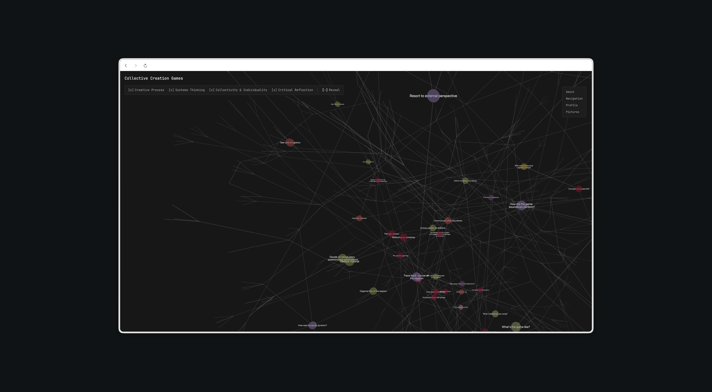

# Spatial Knowledge

Interactive 3D Knowledge Bases.



A single-page site that renders a knowledge base as an interactive 3D graph. Live at [collectivecreationgames.com](https://collectivecreationgames.com).

## How to use

- Drag to rotate the graph, scroll to zoom, right-drag to pan.
- Click a node to reveal its children. Click it again to hide all of its descendants.
- Use the checkboxes in the toolbar to hide or show whole themes.
- "Reveal" shows the entire knowledge base at once.
- On mobile the graph is read-only and shows a curated subset.

## Development

```bash
npm install
npm run dev
```
